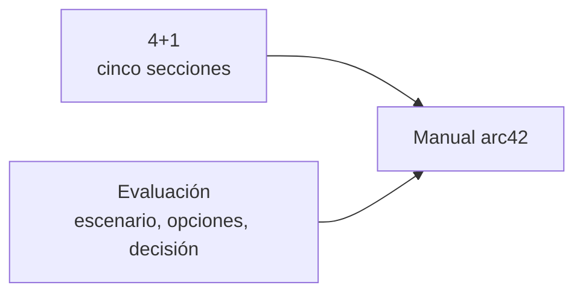

<p align="right">Idioma:&emsp;<a href="README.md" style="vertical-align:middle"></a> </p>

# Arquitecto de software (`plugin-software-architect`)

Escribe documentos de arquitectura que se pueden seguir. Cada sección explicada son unas frases claras y un diagrama. El diagrama del archivo es una explicación. Un dibujo UML, cuando la vista lo necesita, se pide a `plugin-uml-diagrams` y se enlaza.

Tres productos. El manual arc42 cita los otros dos. No los copia.



Las instrucciones están en inglés. El archivo que guarda el plugin sigue el idioma del pedido. Los archivos van en `adrenaline/software-architect/`.

## 4+1

`/arch-4plus1` escribe un archivo con cinco secciones: lógica, desarrollo, proceso, física y los escenarios que las atan. No necesita los otros documentos antes. Nombra la carpeta. El command la lee.

## /arch-4plus1

Lee la carpeta que nombres. Un documento, cinco secciones. Cada una de las cuatro vistas tiene un texto corto y un diagrama. La sección de escenarios cita casos de uso. Si no los pegas, esa sección queda en hueco y el archivo se queda `proposed`.

## /arch-4plus1-logical

Solo la vista lógica: de qué responde cada parte, y un diagrama.

## /arch-4plus1-development

Solo la vista de desarrollo: cómo está organizado el código en la carpeta que nombres, y un diagrama.

## /arch-4plus1-process

Solo la vista de proceso: cómo se llaman las partes, un diagrama y una secuencia UML 2 de `plugin-uml-diagrams`.

## /arch-4plus1-physical

Solo la vista física: dónde corre cada parte, un diagrama y un despliegue UML 2 de `plugin-uml-diagrams`.

## /arch-4plus1-scenarios

El «+1». Qué casos de uso recorren las cuatro vistas. Los cita. No los redacta. Pega los casos de uso en el mismo mensaje.

## arc42

`/arch-arc42` escribe el manual de doce secciones. Las secciones que son vistas enlazan un 4+1 accepted. La de decisiones enlaza los ADR accepted. La de calidad enlaza los escenarios de calidad accepted. Un enlace que falta es un hueco, y el manual se queda `proposed`.

## /arch-arc42

Lee la carpeta que nombres. El manual completo. Cita el 4+1 y la evaluación cuando esos archivos ya están `accepted`.

## /arch-arc42-context

Qué queda fuera del sistema, con un diagrama del límite.

## /arch-arc42-strategy

Metas de calidad, restricciones y el enfoque elegido.

## /arch-arc42-concepts

Lo que se repite entre las partes.

## /arch-arc42-risks

Lo que una fuente ya dice que está mal o sin decidir. No inventa un riesgo.

## /arch-arc42-glossary

Un término por concepto de esta arquitectura.

## Evaluación

Una decisión, en tres pasos: el escenario de calidad, las opciones y el registro de la elección. El escenario de aquí es una comprobación de calidad. No son los escenarios del 4+1.

## /arch-evaluation

Los tres pasos en un archivo, más un diagrama de las opciones. Si aún no se elige una opción, el archivo se queda `proposed`.

## /arch-evaluation-scenario

La preocupación en seis partes, con un nombre de ISO/IEC 25010:2023.

## /arch-evaluation-tradeoff

Al menos dos opciones y lo que cuesta cada una, con un diagrama.

## /arch-evaluation-adr

Una decisión ya tomada: contexto, decisión y consecuencias.

## Ayuda

## /arch-help

El catálogo de este plugin. No escribe un archivo.

## Para quién es

Quien quiere la arquitectura explicada, con un diagrama en cada vista. El caso de uso queda en `plugin-project-manager`. El dibujo UML queda en `plugin-uml-diagrams`. El contrato queda en `plugin-apis`. El modelo de amenazas queda en `plugin-security`. El modelo de datos queda en `plugin-data`. El modelo de dominio queda en `plugin-backend`. Un tutorial o un how-to queda en `plugin-documentation`. Este plugin no copia sus skills.

## Qué incluye

Portable, para cualquier agente que siga [Agent Skills](https://agentskills.io/specification):

- `describe-architecture` escribe el 4+1 y el manual arc42.
- `evaluate-architecture` escribe el escenario, el tradeoff y la decisión.

Cursor y Claude Code: los commands de arriba. En Cursor, `/arch-4plus1`. En Claude Code, `/plugin-software-architect:arch-4plus1`.

Solo Cursor: las rules `output-folder`, `architecture-description` y `architecture-evaluation`. Claude Code no carga rules. Las mismas restricciones están en los skills.

## Instalar

En Cursor, instala el plugin desde este repositorio en Customize.

En Claude Code:

```text
claude plugin marketplace add ADRenaline-Suite/plugin-software-architect
claude plugin install plugin-software-architect@plugin-software-architect
```

Para probar una copia local, arranca Claude Code con `claude --plugin-dir <ruta de este repositorio>`.
