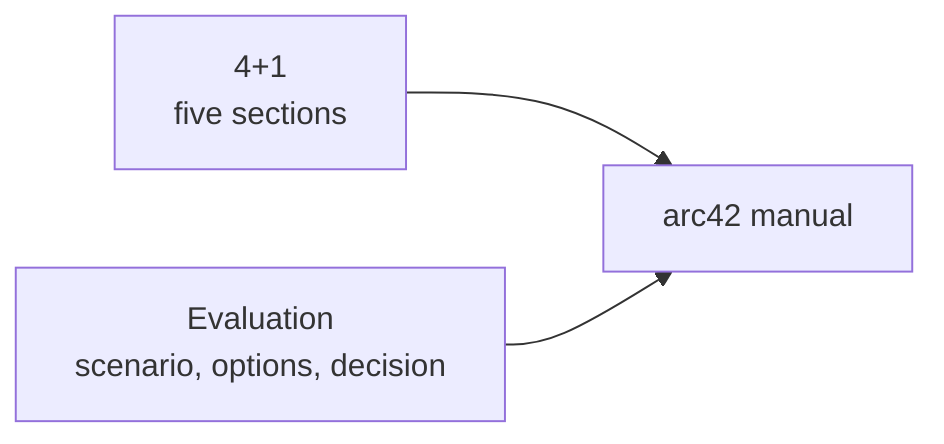

<p align="right">Language:&emsp; <a href="README.es.md" style="vertical-align:middle"></a></p>

# Software Architect (`plugin-software-architect`)

Writes architecture documents a reader can follow. Each explained section is a few plain sentences and one diagram. The diagram in the file is an explanation. A UML drawing, when the view needs one, is asked of `plugin-uml-diagrams` and linked.

Three products. The arc42 manual cites the other two. It does not copy them.



The instructions are in English. The file the plugin saves follows the language of the request. Files go in `adrenaline/software-architect/`.

## 4+1

`/arch-4plus1` writes one file with five sections: logical, development, process, physical, and the scenarios that tie them. It does not need the other documents first. Name the folder. The command reads it.

## /arch-4plus1

Read the folder you name. One document, five sections. Each of the four views has a short text and a diagram. The scenarios section cites use cases. If you do not paste them, that section stays a gap and the file stays `proposed`.

## /arch-4plus1-logical

Only the logical view: what each part is responsible for, and one diagram.

## /arch-4plus1-development

Only the development view: how the code is organized in the folder you name, and one diagram.

## /arch-4plus1-process

Only the process view: how the parts call each other, one diagram, and a UML 2 sequence from `plugin-uml-diagrams`.

## /arch-4plus1-physical

Only the physical view: where each part runs, one diagram, and a UML 2 deployment from `plugin-uml-diagrams`.

## /arch-4plus1-scenarios

The "+1". Which use cases walk the four views. It cites them. It does not write them. Paste the use cases in the same message.

## arc42

`/arch-arc42` writes the twelve-section manual. Sections that are views link an accepted 4+1. The decisions section links accepted ADRs. The quality section links accepted quality scenarios. A missing link is a gap, and the manual stays `proposed`.

## /arch-arc42

Read the folder you name. The full manual. It cites the 4+1 and the evaluation when those files are already `accepted`.

## /arch-arc42-context

What sits outside the system, with one diagram of the boundary.

## /arch-arc42-strategy

Quality goals, constraints, and the chosen approach.

## /arch-arc42-concepts

What repeats across the parts.

## /arch-arc42-risks

What a source already says is wrong or undecided. It does not invent a risk.

## /arch-arc42-glossary

One term per concept in this architecture.

## Evaluation

One decision, in three steps: the quality scenario, the options, and the record of the choice. The scenario here is a quality check. It is not the 4+1 scenarios.

## /arch-evaluation

The three steps in one file, plus a diagram of the options. If no option is chosen yet, the file stays `proposed`.

## /arch-evaluation-scenario

The concern in six parts, with one name from ISO/IEC 25010:2023.

## /arch-evaluation-tradeoff

At least two options and what each one costs, with one diagram.

## /arch-evaluation-adr

A decision already taken: context, decision, and consequences.

## Help

## /arch-help

The catalog of this plugin. It does not write a file.

## Who it is for

Someone who wants the architecture explained, with a diagram in each view. The use case stays with `plugin-project-manager`. The UML drawing stays with `plugin-uml-diagrams`. The contract stays with `plugin-apis`. The threat model stays with `plugin-security`. The data model stays with `plugin-data`. The domain model stays with `plugin-backend`. A tutorial or a how-to stays with `plugin-documentation`. This plugin does not copy their skills.

## What it includes

Portable, for any agent that follows [Agent Skills](https://agentskills.io/specification):

- `describe-architecture` writes the 4+1 and the arc42 manual.
- `evaluate-architecture` writes the scenario, the tradeoff, and the decision.

Cursor and Claude Code: the commands above. In Cursor, `/arch-4plus1`. In Claude Code, `/plugin-software-architect:arch-4plus1`.

Cursor only: rules `output-folder`, `architecture-description`, and `architecture-evaluation`. Claude Code does not load rules. The same restrictions are in the skills.

## Install

In Cursor, install the plugin from this repository in Customize.

In Claude Code:

```text
claude plugin marketplace add ADRenaline-Suite/plugin-software-architect
claude plugin install plugin-software-architect@plugin-software-architect
```

To try a local copy, start Claude Code with `claude --plugin-dir <path to this repository>`.
